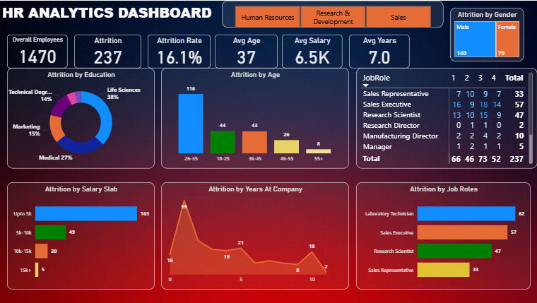

# 📊 HR Analytics Dashboard – Power BI

An interactive HR Analytics Dashboard built using Microsoft Power BI to analyze employee attrition and workforce trends.

---

## 📌 Project Overview

This project focuses on analyzing employee attrition and workforce patterns using an interactive Power BI dashboard.

The dashboard provides a clear overview of employee attrition across different dimensions such as department, gender, education, age group, salary slab, years at company, and job role.

Interactive filters and visuals allow users to explore the data and understand different employee attrition patterns.

---

## 🎯 Project Objective

The main objective of this project is to analyze employee attrition and workforce characteristics using data visualization and business intelligence techniques.

The dashboard helps analyze:

- Overall employee count
- Employee attrition
- Attrition rate
- Average employee age
- Average salary
- Average years at company
- Gender-wise attrition
- Education-wise attrition
- Age-wise attrition
- Salary-wise attrition
- Job-role-wise attrition
- Employee tenure patterns
- Department-wise analysis

---

## 📊 Key KPIs

The dashboard contains the following key performance indicators:

| KPI | Value |
|---|---:|
| Overall Employees | 1,470 |
| Attrition | 237 |
| Attrition Rate | 16.1% |
| Average Age | 37 |
| Average Salary | 6.5K |
| Average Years at Company | 7.0 |

These KPIs dynamically respond to the selected filters and slicers.

---

## 📈 Dashboard Analysis

### Attrition by Gender

The dashboard analyzes employee attrition based on gender and provides a comparison between male and female employees.

### Attrition by Education

Employee attrition is analyzed across different educational backgrounds, including Life Sciences, Medical, Marketing, Technical Degree, Human Resources, and other fields.

### Attrition by Age

The dashboard analyzes employee attrition across different age groups to identify age-related attrition patterns.

### Attrition by Job Role

The dashboard provides job-role-wise attrition analysis and highlights roles with higher numbers of employee attrition.

### Attrition by Salary Slab

Employee attrition is analyzed across different salary ranges to understand salary-related attrition patterns.

### Attrition by Years at Company

The dashboard analyzes attrition according to the number of years employees have spent at the company.

### Department Analysis

An interactive department slicer allows users to filter the dashboard by:

- Human Resources
- Research & Development
- Sales

Selecting a department dynamically updates the dashboard visuals and KPI values.

---

## 🛠️ Tools & Technologies

- Microsoft Power BI
- DAX
- Power Query
- Data Visualization
- Data Analysis

---

## 🔍 Power BI Features Used

The project uses the following Power BI features:

- KPI Cards
- Slicers
- Bar Charts
- Column Charts
- Donut Chart
- Area Chart
- Tables
- Filters
- Data Labels
- Interactive Visuals
- Dynamic Filtering
- DAX Measures
- Dashboard Formatting

---

## 📂 Project Files

| File | Description |
|---|---|
| `HR_Analytics_Dashboard.pbix` | Complete Power BI dashboard |
| `HR_Analytics.csv` | Source HR analytics dataset |
| `dashboard_preview.png` | Dashboard preview image |
| `README.md` | Project documentation |

---

## 🚀 How to Use

1. Download the repository.
2. Open `HR_Analytics_Dashboard.pbix` using Microsoft Power BI Desktop.
3. If Power BI asks for the source dataset, select `HR_Analytics.csv`.
4. Use the department slicer and other dashboard visuals to explore the analysis.
5. Interact with the visuals to dynamically filter the dashboard.

---

## 💡 Key Insights

The dashboard enables analysis of:

- Overall employee attrition
- Attrition rate
- Gender-wise attrition
- Education-wise attrition
- Age-group-wise attrition
- Salary-slab-wise attrition
- Job-role-wise attrition
- Years-at-company patterns
- Department-level employee trends

These insights can help understand employee attrition patterns and workforce characteristics.

---

## 📸 Dashboard Preview

---

## 🎓 Skills Demonstrated

This project demonstrates practical skills in:

- Data Analysis
- Data Visualization
- Power BI
- DAX
- Power Query
- Dashboard Development
- KPI Development
- Interactive Reporting
- Business Analytics

---

## 👨‍💻 Author

**Yogesh Pal**

B.Tech – Computer Science Engineering (AI & ML)

Aspiring Data Analyst

Skills: Power BI | SQL | Python | Excel | Data Analytics

---

## 📌 Project Purpose

This project was developed as a learning and portfolio project to demonstrate practical skills in HR analytics, Power BI dashboard development, DAX, data visualization, and interactive business reporting.